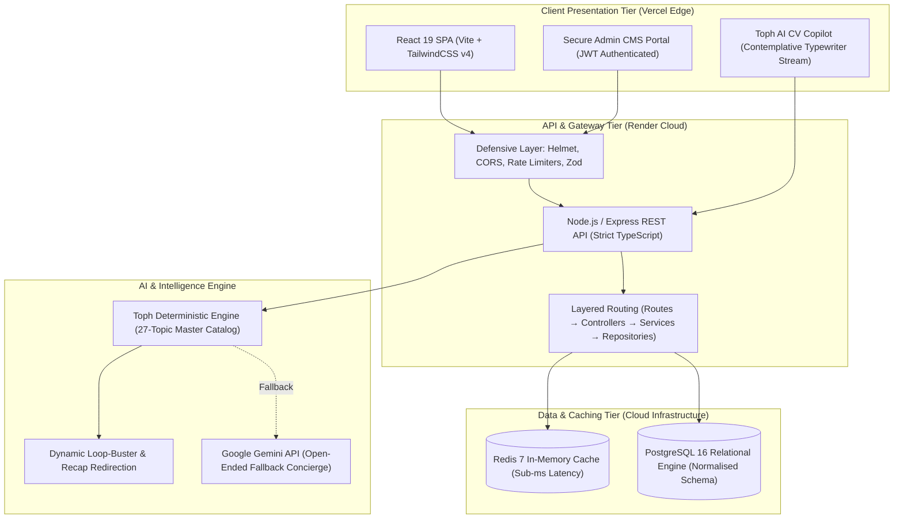

# Hafizi Ahmar — Full-Stack Portfolio & Headless CMS Engine

[](https://github.com/hafiziahmar/portfolio)
[](https://hafizi-portfolio.vercel.app)
[](https://hafizi-portfolio-api.onrender.com)
[](https://github.com/hafiziahmar/portfolio)
[](https://github.com/hafiziahmar/portfolio)

> **AI-Enabled Full-Stack Developer | Autonomous Workflows | Clinical Healthcare Foundation (Dietetics Hons.)**  
> *Translating operational rigor and algorithmic thinking into production-grade, database-driven web systems.*

---

## 🏛️ Executive Architectural Overview

This system is engineered as an enterprise-grade, database-backed portfolio and content management engine designed to showcase full-stack software architecture, data integrity, and defensive engineering.

Rather than relying on static site generation, this platform operates on a **decoupled, event-driven multi-tier architecture**:



---

## ⚙️ Core Engineering Design Decisions

### 1. Relational PostgreSQL Schema & Strict Data Integrity
All portfolio data — professional experiences, technical skill inventories, capstone projects, education credentials, and incoming recruiter messages — are modelled into normalised PostgreSQL tables:
- **Foreign Constraints & Parameterised Queries**: Strict SQL parameterisation (`$1, $2, ...`) eliminates SQL injection vectors.
- **Concurrency Control**: Employs PostgreSQL row-level locks (`FOR UPDATE SKIP LOCKED`) in multi-user workflows to prevent data race conditions.
- **Automated Versioned Migrations**: SQL DDL schemas run idempotently upon application initialisation.

### 2. High-Throughput Redis Caching with Write-Through Invalidation
To minimise database read amplification while ensuring instantaneous global updates:
- Public portfolio reads (`GET /api/portfolio`) are cached in Redis with a 300-second TTL.
- Any write operation in the Admin CMS (e.g. updating a project, adding a new skill category, or modifying bio details) immediately triggers **atomic cache eviction** (`redis.del('portfolio:full')`).
- If Redis is unreachable, the backend automatically fails over to an in-memory cache without dropping client traffic.

### 3. Layered Enterprise Architecture
The backend strictly adheres to a 4-layer architectural separation:
1. **Routes**: Declarative HTTP endpoint definitions and authentication guards.
2. **Controllers**: Request extraction, HTTP status coordination, and response serialisation.
3. **Services**: Business logic, cache synchronisation, and AI copilot query dispatching.
4. **Repositories**: Pure SQL abstraction and database access operations.

### 4. Defensive Security & Zero-Trust Authentication
- **Stateless Authentication**: Admin endpoints require cryptographically signed JSON Web Tokens (JWT) verified via middleware.
- **Bcrypt Password Hashing**: Passwords stored using 10 salt rounds with constant-time verification.
- **Zod Runtime Contracts**: All incoming HTTP payloads undergo strict type-checking and sanitisation before hitting business services.
- **Anti-Bot & Rate Limiting**: Dedicated rate-limiting tiers (`copilotLimiter`, `contactLimiter`) throttle automated scraping and denial-of-service attempts.

---

## 🤖 AI CV Copilot Engine: "Toph"

The portfolio features **Toph**, an integrated engineering copilot built to provide recruiters with direct, real-time insights into Hafizi's architecture, technical decisions, and background:

### 1. Deterministic 27-Topic Master Knowledge Base
Toph is powered by a high-precision, sub-second deterministic engine with zero hallucination, covering **exactly 27 structured topics**:
- **Career Journey & Leadership (9 Topics)**: `why_hire`, `clinical`, `nvc`, `takaful`, `puncak_niaga`, `mafi`, `mdec`, `42kl`, `kada`.
- **Full-Stack & Backend Systems (8 Topics)**: `backend_layers`, `postgres`, `redis`, `security`, `zod`, `react19`, `typescript`, `error_handling`.
- **Verification & Engineering Tools (4 Topics)**: `postman`, `git`, `prompt_ai`, `capabilities`.
- **URUS Capstone Module (2 Topics)**: `urus_overview`, `urus_barcode`.
- **System Identity & Recruiter Boundaries (4 Topics)**: `toph`, `portfolio_architecture`, `contact_channels`, `personal_boundary`.

### 2. State-Aware Loop-Buster & Smart Recap Algorithm
- **First-Time Topic Queries**: Renders a comprehensive, technical answer with architectural rationale and metrics.
- **Topic Re-Queries**: Automatically detects that the topic was previously visited and delivers a concise **Smart Recap** to acknowledge context without duplicating text.
- **Dynamic Leading Redirections**: Proactively suggests the next logical, unvisited topic in the knowledge graph, mathematically preventing circular suggestion loops.

### 3. Contemplative Pacing & Smooth Typewriter Streaming
- **2.0-Second Simulated Thinking Pause**: Displays an animated *"Analysing CV context..."* status, simulating realistic neural analysis.
- **Natural Typewriter Stream**: Answers stream word-by-word over ~3.5 seconds with an active pulsing indicator cursor.
- **Instant Skip Shortcut**: Recruiters can click anywhere on the message bubble to instantly reveal the full response.
- **Domain-Priority Tie-Breaker**: Polite conversational phrasing (*"Can you tell me about NVC?"*) prioritises specific technical domains (`nvc`) over generic greetings (`toph`).

---

## 🛡️ Privacy & Contact Protection Architecture

In adherence to strict personal privacy standards:
- **Zero Raw PII Exposure**: Private phone numbers, residential addresses, and personal email addresses are intentionally excluded from public DOM and client bundles.
- **Authenticated Message Queue**: Recruiter inquiries route through a secure, backend-validated **Contact Queue**. Inquiries are stored directly in PostgreSQL with honeypot spam protection and triaged exclusively within the authenticated Admin CMS.
- **AI Privacy Guardrails**: Toph enforces strict system boundary constraints, deflecting queries targeting private personal details while facilitating verified communication via the contact form, LinkedIn, or GitHub.

---

## 🎨 Natural Earth & Warm Sand Design System

The frontend user experience is built upon an organic, nature-inspired palette tailored for readability, focus, and zero eye fatigue:

| Element | Light Mode (Warm Sand) | Dark Mode (Mossy Charcoal) |
| :--- | :--- | :--- |
| **Canvas Background** | `#F7F4EE` (Soft Warm Sand) | `#171C18` (Deep Mossy Charcoal) |
| **Surface Cards** | `#FFFFFF` (Organic White) | `#222923` (Deep Earth Slate) |
| **Primary Typography** | `#2C2B29` (Deep Earth Bark) | `#EBE7DF` (Soft Pale Mist) |
| **Primary Accent** | `#5E6C5B` (Muted Forest Moss) | `#83967F` (Soft Sage Green) |
| **Interactive Accent**| `#C27803` (Warm Amber Sun) | `#F59E0B` (Warm Amber Glow) |
| **Borders & Dividers**| `#E3DDD2` (Sand Muted Border) | `#2E382F` (Deep Slate Border) |

- **TailwindCSS v4**: Modern CSS-first configuration using CSS variables and semantic theme classes.
- **Ergonomics**: Relaxed readability layout with semantic HTML5 structuring and unified singular navigation (`About • Project • Experience • Skill • Education • Contact`).

---

## 📡 REST API Reference

| Method | Endpoint | Access | Purpose |
| :--- | :--- | :--- | :--- |
| `GET` | `/api/health` | Public | System health check and uptime timestamp |
| `GET` | `/api/portfolio` | Public | Full portfolio payload (Redis-cached, sub-5ms response) |
| `POST` | `/api/messages` | Public (Rate Limited) | Submit recruiter contact inquiry (Zod validated, honeypot protected) |
| `POST` | `/api/copilot/chat` | Public (Rate Limited) | Query Toph AI CV Copilot |
| `POST` | `/api/auth/login` | Public | Authenticate administrator via bcrypt & issue JWT |
| `GET` | `/api/auth/me` | Admin (JWT) | Validate active admin session |
| `PUT` | `/api/admin/profile` | Admin (JWT) | Update headline, summary, or availability status |
| `POST` | `/api/admin/projects` | Admin (JWT) | Add a new project to the portfolio |
| `PUT` | `/api/admin/projects/:id` | Admin (JWT) | Update project name, dates, or technical description |
| `DELETE` | `/api/admin/projects/:id` | Admin (JWT) | Delete a project record |
| `POST` | `/api/admin/education` | Admin (JWT) | Add an education or training credential |
| `PUT` | `/api/admin/education/:id` | Admin (JWT) | Update education title, provider, dates, or description |
| `DELETE` | `/api/admin/education/:id` | Admin (JWT) | Delete an education credential |
| `POST` | `/api/admin/skills` | Admin (JWT) | Add a new skill (with custom dynamic category support) |
| `DELETE` | `/api/admin/skills/:id` | Admin (JWT) | Delete a skill record |
| `GET` | `/api/admin/messages` | Admin (JWT) | Retrieve incoming recruiter inquiries |
| `PATCH`| `/api/admin/messages/:id/status` | Admin (JWT) | Update inquiry status (`unread` → `read` → `replied` → `archived`) |
| `POST` | `/api/admin/cache/flush` | Admin (JWT) | Invalidate and flush all Redis cache keys |

---

## 🚀 Production Deployment & Infrastructure

The application operates on a decoupled modern production pipeline:

```
┌─────────────────────────────────┐        ┌─────────────────────────────────┐
│     Vercel Edge Network         │        │       Render Cloud Platform     │
│   (React 19 SPA + Tailwind v4)  │        │   (Node.js / Express REST API)  │
│                                 │        │                                 │
│  • Edge-accelerated global CDN  │  HTTP  │  • Layered Clean Architecture   │
│  • Automated SPA rewrites       ├───────►│  • Strict JWT authentication    │
│  • Sub-25s atomic deployments   │        │  • Zod validation & rate limits │
└─────────────────────────────────┘        └──────────────┬──────────────────┘
                                                          │
                                         ┌────────────────┴──────────────────┐
                                         ▼                                   ▼
                             ┌───────────────────────┐           ┌───────────────────────┐
                             │  Supabase PostgreSQL  │           │   Upstash / Redis 7   │
                             │  (Singapore Region)   │           │   (Cache-Aside Layer) │
                             └───────────────────────┘           └───────────────────────┘
```

- **Frontend Hosting**: Deployed on **Vercel** with automated SPA routing rules configured via [`vercel.json`](vercel.json).
- **Backend Hosting**: Deployed on **Render** as a long-running Node.js web service.
- **Database Engine**: Managed PostgreSQL 16 on **Supabase** (Singapore region) with connection pooling (`pg.Pool`).
- **In-Memory Cache**: Managed Redis 7 cluster for sub-millisecond portfolio read acceleration.

---

## 💻 Local Engineering Environment

### Infrastructure Requirements
- **Runtime**: Node.js v20+ / npm v10+
- **Containers**: Docker Desktop (PostgreSQL 16 Alpine + Redis 7 Alpine)

### Container Orchestration
```bash
# Launch PostgreSQL and Redis instances in isolated containers
docker compose up -d

# Verify container health
docker ps
```

### Environment Configuration
Sensitive values and secrets are managed exclusively through untracked environment files:
- Backend: `backend/.env` (configured from `backend/.env.example`)
- Frontend: `frontend/.env` (configured from `frontend/.env.example`)

### Development Servers
```bash
# In workspace root
npm run dev:backend     # Runs Express REST API on http://localhost:5000
npm run dev:frontend    # Runs Vite + React 19 SPA on http://localhost:5173
```

---

## 👨‍💻 Engineering Profile & Contact

**Hafizi Ahmar**  
*AI-Enabled Full-Stack Developer | Autonomous Workflows | Clinical Healthcare Foundation*

- **LinkedIn**: [linkedin.com/in/ahmad-hafizi-ahmar](https://www.linkedin.com/in/ahmad-hafizi-ahmar)
- **GitHub**: [github.com/hafiziahmar](https://github.com/hafiziahmar)
- **Direct Recruiter Inquiries**: Verified communication is handled through the **Contact Queue Form** on the portfolio to ensure zero-spam delivery.

---
*Architected and engineered with precision, defensive security, and natural earth ergonomics.*
